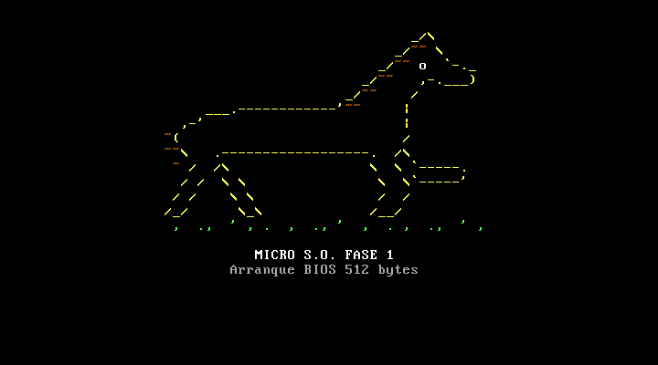
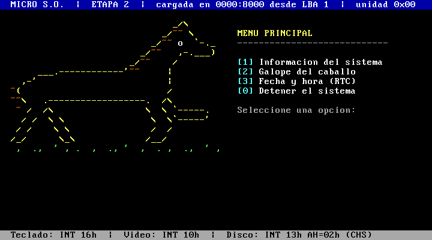
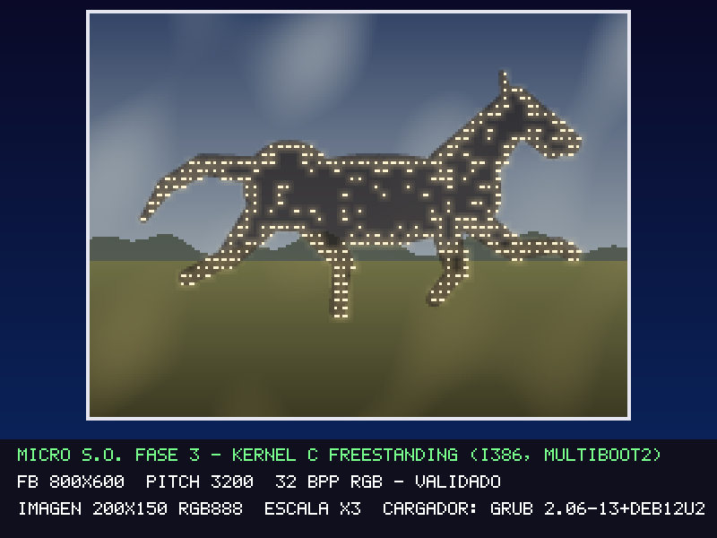

# Guía N° 1 — Boot de Micro S.O. en QEMU

**INFB6074 Infraestructura para Ciencia de Datos** · Ingeniería Civil en Ciencia de Datos · UTEM · 2.º semestre 2026
**Estudiante:** _FELIPE CANALES HUERTA_ · **Docente:** Dr. Ing. Michael Miranda Sandoval

Un micro sistema operativo construido en tres fases: un sector de arranque de 512 bytes que dibuja un caballo al galope en ASCII, un arranque en dos etapas con menú interactivo y un kernel C freestanding que despliega una imagen en el framebuffer. Todo se construye desde los fuentes y se ejecuta en QEMU.

## Contenido

| Fase | Carpeta | Qué hace | Estado |
| :--- | :--- | :--- | :--- |
| 1 | [`fase-1/`](fase-1/) | Sector de arranque BIOS de 512 bytes con dibujo ASCII a color | ✅ Terminada |
| 2 | [`fase-2/`](fase-2/) | Etapa 1 carga la etapa 2 desde un disquete; menú con 4 opciones | ✅ Terminada |
| 3 | [`fase-3/`](fase-3/) | GRUB + Multiboot2 cargan un kernel C que dibuja una imagen en 800x600x32 | ✅ Terminada |

Otros archivos:

- [`informe_guia1.pdf`](informe_guia1.pdf) — informe integrador (3 páginas); su fuente editable es [`informe_guia1.md`](informe_guia1.md)
- [`evidencias/video_guia1.mp4`](evidencias/video_guia1.mp4) — video demostrativo (3 min 45 s): Fase 1 (`fase-1/build.sh run`), Fase 2 (`fase-2/scripts/build.sh run` y `fallo`) y Fase 3 (`qemu-system-i386 -cdrom fase-3/build/micro_so_f3.iso`)
- [`herramientas/captura_qemu.py`](herramientas/captura_qemu.py) — arranca QEMU sin ventana, envía teclas y guarda capturas con `screendump`
- [`herramientas/generar_evidencias.sh`](herramientas/generar_evidencias.sh) — reconstruye las tres fases y vuelve a tomar todas las capturas

```text
guia-1/
├── README.md
├── informe_guia1.md / .pdf
├── fase-1/   boot_f1.asm, build.sh, build/, evidencias/
├── fase-2/   src/, scripts/, build/, evidencias/, README.md
├── fase-3/   kernel/, boot/, assets/, scripts/, build/, figuras/, evidencias/, README.md
├── herramientas/
└── evidencias/
```

## Entorno y versiones

| Herramienta | Versión usada | Para qué |
| :--- | :--- | :--- |
| Windows 11 | 10.0.26300 | sistema anfitrión |
| NASM | 3.01 | ensamblar las fases 1 y 2 |
| QEMU (`qemu-system-i386`) | 11.0.0 | emular el PC x86 |
| Git | 2.54.0 | versionado |
| Python | 3.14 | capturas automáticas (solo biblioteca estándar) |
| Docker Desktop | 29.9.1 | contenedor Linux para construir la Fase 3 |
| Contenedor Debian 12 | gcc 12.2.0, binutils 2.40, NASM 2.16.01, GRUB 2.06, xorriso 1.5.4 | compilar el kernel y armar la ISO |

Las fases 1 y 2 solo necesitan NASM y QEMU. La Fase 3 necesita, además, gcc, ld, GRUB y xorriso. En Windows y macOS esas herramientas se obtienen con Docker; en Linux también pueden instalarse directamente (ver [`fase-3/README.md`](fase-3/README.md)).

## Revisión rápida

Los scripts son POSIX `sh`: en Windows se ejecutan desde **Git Bash** o la terminal **UCRT64 de MSYS2**, con `nasm` y `qemu-system-i386` en el `PATH`. Todos los comandos se ejecutan desde la carpeta `guia-1/`.

```bash
sh fase-1/build.sh run            # Fase 1: ensambla, verifica 512 B + 55AA y arranca
sh fase-2/scripts/build.sh run    # Fase 2: arma el disquete y arranca (teclas 1, 2, 3, 0)
sh fase-3/scripts/build_docker.sh # Fase 3: compila kernel e ISO dentro de Docker
qemu-system-i386 -cdrom fase-3/build/micro_so_f3.iso -serial stdio
```

Para reconstruir todo y regenerar las capturas de `*/evidencias/`:

```bash
sh herramientas/generar_evidencias.sh
```

Si en Windows `nasm` o `qemu-system-i386` no se reconocen, agregue sus carpetas al `PATH` de la sesión. En Git Bash:

```bash
export PATH="/c/Program Files/NASM:/c/Program Files/qemu:$PATH"
```

## Resultado de cada fase

| Fase 1 | Fase 2 | Fase 3 |
| :---: | :---: | :---: |
|  |  |  |
