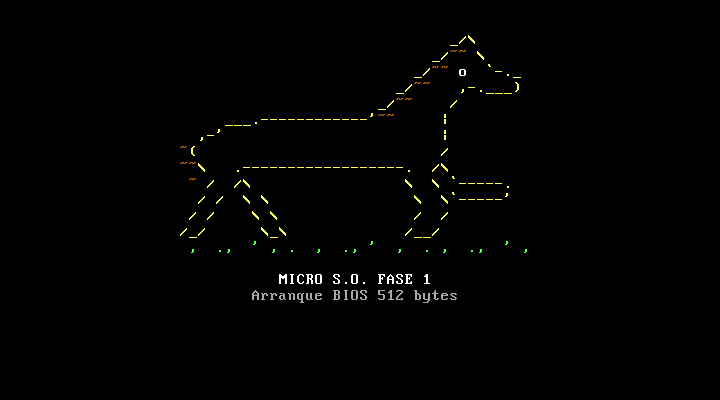

# Fase 1 — Sector de arranque de 512 bytes con dibujo ASCII

Al encender el PC emulado, el BIOS lee el primer sector del disquete, comprueba que termine en `55 AA`, lo copia a la dirección `0000:7C00` y le cede el control en modo real de 16 bits. [`boot_f1.asm`](boot_f1.asm) ocupa ese sector: limpia la pantalla, oculta el cursor y dibuja un caballo al galope a color (diseño propio) con los servicios de video del BIOS.



## Archivos

| Archivo | Contenido |
| :--- | :--- |
| `boot_f1.asm` | fuente comentado; el dibujo está dentro del fuente, en la etiqueta `dibujo:` |
| `build.sh` | ensambla y comprueba tamaño y firma; con `run` además arranca QEMU |
| `build/boot_f1.bin` | sector ensamblado (512 bytes) |
| `build/boot_f1.lst` | listado de NASM: dirección y bytes de cada instrucción |
| `evidencias/arranque_f1-qemu.png` | captura de QEMU tomada con `screendump` |

## Construir y ejecutar

Desde `guia-1/`, en Git Bash, MSYS2, Linux o macOS:

```bash
sh fase-1/build.sh run
```

Salida esperada:

```text
build/boot_f1.bin: 512 bytes, bytes 510-511 = 55aa
OK: sector de arranque valido
```

Mismos pasos a mano, desde `guia-1/fase-1/` (también funcionan en PowerShell):

```bash
nasm -f bin boot_f1.asm -o build/boot_f1.bin
qemu-system-i386 -drive file=build/boot_f1.bin,format=raw,if=floppy
```

Para revisar la firma en PowerShell: `Format-Hex build/boot_f1.bin | Select-Object -Last 1` muestra `55 AA` al final de la fila `000001F0`.

## Cómo funciona

1. **Inicialización.** Pone `DS = ES = SS = 0` y la pila en `0x7C00`, de modo que las etiquetas del programa son direcciones válidas (`org 0x7C00`).
2. **Pantalla.** `INT 10h AH=00h` con modo `03h` (texto 80x25, 16 colores) limpia la pantalla; `INT 10h AH=01h` oculta el cursor.
3. **Dibujo.** El caballo se guarda como un flujo de bytes con un formato propio que ahorra espacio:

   | Byte | Significado |
   | :--- | :--- |
   | `0x00` | fin del dibujo |
   | `0x0A` | salto de línea (fila + 1, vuelve al margen) |
   | `0x01`–`0x1F` | avanzar N columnas sin escribir (espacios gratis) |
   | `0x80`–`0xFF` | cambiar color: atributo = byte AND `0x7F` |
   | otro | carácter que se escribe con el color actual |

   Cada carácter se escribe con `INT 10h AH=09h` (carácter + atributo de color) y el cursor se mueve con `INT 10h AH=02h`. El teletipo `AH=0Eh` del ejemplo de la guía no admite color en modo texto; por eso se reemplazó.
4. **Detención.** `CLI` + `HLT` en bucle: la CPU queda detenida sin consumir ciclos.
5. **Relleno y firma.** `times 510-($-$$) db 0` y `dw 0xAA55`. Si el código pasara de 510 bytes, NASM fallaría con *TIMES value is negative*, así que el tamaño también se comprueba al ensamblar.

El programa usa 360 de los 510 bytes disponibles: el resto es relleno (`build/boot_f1.lst`). El dibujo se diseña como texto en [`herramientas/ascii_a_nasm.py`](../herramientas/ascii_a_nasm.py), que genera las líneas `db` (cada racha de espacios pasa a ser un byte "avanzar N columnas").
