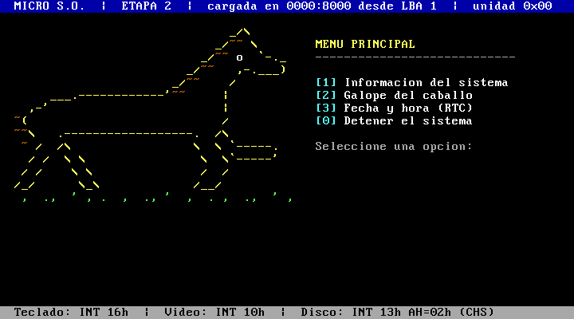

# Fase 2 — Arranque en dos etapas e interacción

El sector de arranque (etapa 1) ya no dibuja: lee una segunda etapa desde el disquete, comprueba su firma y le transfiere el control. La etapa 2 mantiene el caballo ASCII de la Fase 1 y muestra un menú que responde al teclado.



## Archivos

| Ruta | Contenido |
| :--- | :--- |
| `src/boot_f2.asm` | etapa 1: sector de 512 bytes que carga la etapa 2 |
| `src/etapa2_f2.asm` | etapa 2: barra de estado, dibujo y menú |
| `src/disposicion.inc` | mapa del disco e interfaz entre etapas (lo comparten ambas etapas y el script) |
| `src/video.inc`, `src/dibujo.inc` | colores, formato de dibujo y caballo de la Fase 1 |
| `scripts/build.sh` | ensambla, arma la imagen, verifica tamaños y firmas; `run` / `fallo` arrancan QEMU |
| `build/disco_f2.img` | disquete de 1,44 MB listo para arrancar |
| `build/disco_f2_sin_etapa2.img` | disquete con solo la etapa 1, para la prueba de fallo |
| `build/boot_f2.bin`, `build/etapa2_f2.bin`, `build/*.lst` | artefactos intermedios y listados de NASM |
| `evidencias/` | capturas de QEMU de cada caso de prueba |

## Versiones

NASM 3.01 y QEMU 11.0.0 en Windows 11; el script usa `sh`, `dd`, `od`, `awk` y `wc` (incluidos en Git Bash, MSYS2, Linux y macOS). Probado solo en QEMU con `-drive if=floppy` (disquete de 1,44 MB, unidad `0x00`). No se probó en equipos físicos.

## Construir y ejecutar

Desde `guia-1/`:

```bash
sh fase-2/scripts/build.sh run      # imagen normal
sh fase-2/scripts/build.sh fallo    # imagen sin etapa 2 (error controlado)
```

Salida esperada de la construcción:

```text
boot_f2.bin    512 bytes, firma 55aa   -> LBA 0
etapa2_f2.bin  8192 bytes (16 sectores), firma ETP2 -> LBA 1..16
disco_f2.img   1474560 bytes (2880 sectores)
OK: imagen verificada
```

Para ejecutar sin el script, desde `guia-1/fase-2/`:

```bash
qemu-system-i386 -drive file=build/disco_f2.img,format=raw,if=floppy
```

## Mapa del disco

Disquete de 1,44 MB: 2880 sectores de 512 bytes, geometría CHS de 80 cilindros × 2 cabezas × 18 sectores por pista. Las ubicaciones están en `src/disposicion.inc`; el script lee de ahí `ETAPA2_LBA` y `ETAPA2_SECTORES` para no duplicarlas.

```text
 LBA    CHS (C/H/S)        Bytes            Contenido
┌─────┬──────────────┬───────────────────┬──────────────────────────────────────┐
│ 0   │ 0/0/1        │ 0x00000 - 0x001FF │ Etapa 1: boot_f2.bin                 │
│     │              │                   │   470 B de código y datos + relleno  │
│     │              │                   │   firma 55 AA en los bytes 510-511   │
├─────┼──────────────┼───────────────────┼──────────────────────────────────────┤
│ 1   │ 0/0/2        │ 0x00200 - 0x021FF │ Etapa 2: etapa2_f2.bin               │
│ ... │ ...          │ (16 sectores,     │   bytes 0-3: firma "ETP2"            │
│ 16  │ 0/0/17       │  8 KiB reservados)│   1968 B usados, resto en ceros      │
├─────┼──────────────┼───────────────────┼──────────────────────────────────────┤
│ 17  │ 0/0/18       │ 0x02200 - ...     │ Sin uso (ceros)                      │
│ ... │ ...          │                   │                                      │
│2879 │ 79/1/18      │ ... - 0x167FFF    │                                      │
└─────┴──────────────┴───────────────────┴──────────────────────────────────────┘
```

En memoria, la etapa 1 queda en `0000:7C00` (puesta ahí por el BIOS) y la etapa 2 en `0000:8000`. La pila crece hacia abajo desde `0000:7C00`.

## Interfaz entre etapas

| Aspecto | Decisión |
| :--- | :--- |
| Método de lectura | `INT 13h AH=02h` con CHS: cilindro 0, cabeza 0, sectores 2 a 17, en una sola llamada. Hasta 3 intentos, con `INT 13h AH=00h` (reiniciar la controladora) entre intentos. |
| Por qué CHS | El dispositivo emulado es un disquete, cuyo BIOS no siempre ofrece las extensiones LBA (`AH=42h`). Como la etapa 2 cabe en la primera pista, basta con una lectura. `disposicion.inc` detiene el ensamblado con `%error` si la etapa 2 dejara de caber en la pista. |
| Dirección de carga | `ES:BX = 0000:8000` |
| Verificación | La etapa 1 compara los 4 primeros bytes leídos con `"ETP2"`. Si no coinciden, informa el error y se detiene en lugar de saltar a basura. |
| Unidad de arranque | El BIOS la entrega en `DL`. La etapa 1 la guarda y la vuelve a poner en `DL` antes del salto; la etapa 2 la muestra en su barra superior. |
| Transferencia | Salto lejano `jmp 0000:8004` (justo después de la firma) |
| Estado de la CPU | Modo real de 16 bits, `CS = DS = ES = SS = 0`, `SP = 0x7C00`, interrupciones habilitadas, modo de video 03h |

## Menú y servicios del BIOS

| Tecla | Respuesta | Servicios |
| :--- | :--- | :--- |
| `1` | Información del sistema: memoria convencional y extendida, modo de video y bytes usados por la etapa 2 | `INT 12h`, `INT 15h AH=88h`, `INT 10h AH=0Fh` |
| `2` | Cuenta regresiva y animación: el caballo galopa de izquierda a derecha hasta salir de la pantalla (se redibuja 2 columnas más allá cada ~110 ms; lo que pasa de la columna 79 se recorta) | `INT 10h AH=06h` (limpiar ventana), contador de ticks del BIOS en `0040:006C` |
| `3` | Fecha y hora del reloj de tiempo real | `INT 1Ah AH=04h` y `AH=02h` (valores BCD) |
| `0` | Detiene el sistema de forma controlada (`CLI` + `HLT`) | — |
| cualquier otra | Mensaje en rojo con el carácter y el código de la tecla; se vuelve a pedir la opción sin redibujar | — |

Después de las opciones 1, 2 y 3, cualquier tecla vuelve al menú.

- **Teclado:** `INT 16h AH=00h` espera una tecla y entrega el código ASCII en `AL` y el código de rastreo en `AH`.
- **Texto:** `INT 10h AH=02h` mueve el cursor, `AH=09h` escribe un carácter con su color y `AH=06h` limpia ventanas. Se reutiliza el formato de dibujo de la Fase 1, ahora para todos los textos.

## Pruebas

Todas las capturas se tomaron con `herramientas/captura_qemu.py`, que envía las teclas por el monitor de QEMU (`sendkey`) y guarda la pantalla emulada con `screendump`.

| # | Caso | Acción | Resultado esperado | Resultado observado | Evidencia |
| :-- | :--- | :--- | :--- | :--- | :--- |
| 1 | Arranque normal: etapa 1 | Arrancar `disco_f2.img` | La etapa 1 informa la lectura de LBA 1 y la firma correcta | Igual a lo esperado; el mensaje queda 2 s en pantalla | [f2_01](evidencias/f2_01_etapa1.png) |
| 2 | Llegada a la etapa 2 | Esperar 2 s | Barra con `0000:8000`, LBA 1 y unidad `0x00`; caballo y menú | Igual a lo esperado | [arranque_f2](evidencias/arranque_f2-qemu.png) |
| 3 | Opción 1 | Tecla `1` | Datos del sistema y aviso para volver | 639 KB convencional, 64512 KB extendida, modo 0x03 de 80 columnas, 1968 bytes usados | [f2_03](evidencias/f2_03_opcion1_info.png) |
| 4 | Opción 3 | `Enter`, tecla `3` | Fecha y hora del RTC | Fecha y hora UTC del anfitrión | [f2_05](evidencias/f2_05_opcion3_reloj.png) |
| 5 | Tecla no válida (imprimible) | `Enter`, tecla `x` | Aviso en rojo y nueva petición, sin bloqueo | `Opcion no valida: 'x' (codigo de tecla 0x2D)`; el menú sigue respondiendo | [f2_06](evidencias/f2_06_tecla_invalida.png) |
| 6 | Tecla no válida (sin ASCII) | Tecla `F1` | Aviso con solo el código de tecla | `codigo de tecla 0x3B` | [f2_06b](evidencias/f2_06b_tecla_sin_ascii.png) |
| 7 | Opción 2 | Tecla `2` | Cuenta 3-2-1, el caballo cruza la pantalla y sale por la derecha; mensaje final | Igual a lo esperado | [f2_04a](evidencias/f2_04a_galope_cuenta.png), [f2_04b](evidencias/f2_04b_galope_carrera.png), [f2_04c](evidencias/f2_04c_galope_final.png) |
| 8 | Opción 0 | `Enter`, tecla `0` | Mensaje de detención y CPU detenida | Igual a lo esperado | [f2_07](evidencias/f2_07_detenido.png) |
| 9 | Fallo controlado: sin etapa 2 | `build.sh fallo` | La etapa 1 lee ceros, no encuentra `ETP2`, informa y se detiene | `Firma ETP2 no encontrada: no hay etapa 2` | [f2_08](evidencias/f2_08_fallo_sin_etapa2.png) |
| 10 | Tamaños y disposición | `build.sh` | 512 B con `55AA`; etapa 2 de 8192 B; `ETP2` en el byte 512 de la imagen | Verificado por el script (`OK: imagen verificada`) | salida del script |

### Análisis del fallo controlado (caso 9)

`disco_f2_sin_etapa2.img` contiene solo la etapa 1. La lectura de `INT 13h` **no falla**: los sectores existen y contienen ceros. Por eso no basta con mirar el indicador de acarreo (`CF`). Sin la comprobación de firma, la etapa 1 saltaría a `0000:8004` y ejecutaría ceros (`add [bx+si], al` repetido) sin ningún aviso. La firma `ETP2` convierte ese caso en un error visible y en una detención controlada.

El camino de error de lectura (`CF = 1` tras 3 intentos, que muestra `AH`) está implementado, pero no se pudo provocar de forma reproducible con un disquete válido de QEMU.

## Problemas encontrados y límites

- **Código de error perdido.** La rutina `imprimir` usa `AH` para el teletipo, lo que borraba el código de error de `INT 13h` antes de mostrarlo. Se detectó al revisar el código y se corrigió guardándolo en la pila.
- **Mensajes de la etapa 1 invisibles.** La etapa 2 limpia la pantalla casi al instante. Se agregó una pausa de ~2 s (36 ticks) en la etapa 1.
- **Barra superior desbordada.** El título pasaba de 80 columnas y se cortaba en dos filas. Se acortó.
- **Sin tildes en pantalla.** En UTF-8, las letras con tilde son bytes ≥ `0x80`, que el formato de dibujo interpreta como cambios de color.
- **Límites.** Lectura CHS de una sola pista (máximo 17 sectores para la etapa 2), sin sistema de archivos ni particiones. Solo se probó en QEMU con disquete. La hora del RTC es la del anfitrión, en UTC por defecto.
