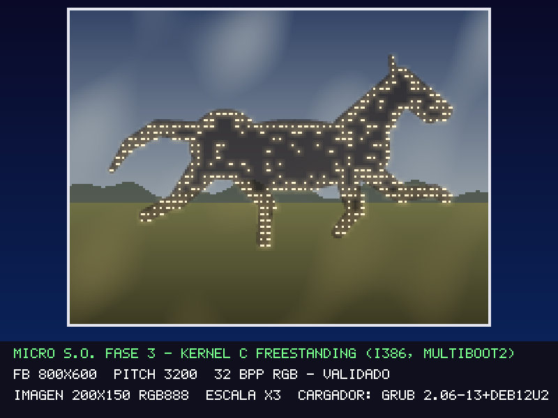

# Fase 3 — Kernel C freestanding con imagen gráfica

**GRUB 2.06** carga, con el protocolo **Multiboot2**, un kernel mínimo escrito en C11 para i386. El kernel valida el framebuffer que le entrega GRUB, muestra un patrón de prueba y dibuja una imagen propia (que GRUB carga como módulo) a escala ×3 en 800×600×32.



## Arquitectura

```text
 BIOS (SeaBIOS de QEMU)
   └─ GRUB 2.06 (ISO El Torito, i386-pc)
        ├─ lee boot/grub.cfg
        ├─ carga kernel_f3.elf en 1 MiB (ELF32, cabecera Multiboot2)
        ├─ carga imagen.img como módulo Multiboot2
        ├─ activa el modo VBE 800x600x32 que pide la cabecera
        └─ salta a _start en modo protegido de 32 bits
             EAX = 0x36D76289 (magic), EBX = dirección de la info Multiboot2
               └─ _start (kernel/boot_f3.asm): pila de 16 KiB, llama a kmain()
                    └─ kmain (kernel/kernel.c)
                         1. valida el magic y la alineación de la info
                         2. recorre las etiquetas: cargador (2), módulo (3), framebuffer (8)
                         3. valida el framebuffer -> si falla: error y detención
                         4. patrón de prueba de 8 barras (2 s)
                         5. valida el módulo IMG1 -> si falla: pantalla de error
                         6. dibuja la imagen y el panel con los parámetros recibidos
```

**El componente que carga el kernel es GRUB** (paquete `grub-pc-bin` de Debian 12, versión `2.06-13+deb12u2`). Las fases 1 y 2 no participan: para usar el cargador recomendado por la guía, la Fase 3 arranca desde su propia ISO.

## Archivos

| Ruta | Contenido |
| :--- | :--- |
| `kernel/boot_f3.asm` | cabecera Multiboot2 (pide 800×600×32) y punto de entrada `_start` |
| `kernel/kernel.c` | `kmain`, recorrido de etiquetas, validaciones, patrón de prueba, dibujo |
| `kernel/pantalla.c/.h` | píxeles, rectángulos y texto con una fuente 5×7 propia |
| `kernel/serie.c/.h` | registro por COM1 (`serie_printf`) |
| `kernel/multiboot2.h` | estructuras de la especificación Multiboot2 que se usan |
| `kernel/puertos.h` | `inb`, `outb` y `detener` |
| `kernel/linker.ld` | enlazado en 1 MiB, con la cabecera Multiboot2 al inicio |
| `boot/grub.cfg` | menú de GRUB: arranque normal y dos entradas de prueba |
| `assets/original/` | `caballo_f3.png`, su generador y [PROCEDENCIA.md](assets/original/PROCEDENCIA.md) |
| `assets/converted/` | `png_a_img.py` (conversor) e `imagen.img` (píxeles RGB888 que lee el kernel) |
| `scripts/build.sh` | receta completa de compilación, enlazado, conversión e ISO (Linux) |
| `scripts/Dockerfile`, `scripts/build_docker.sh` | la misma receta dentro de Debian 12, para Windows y macOS |
| `build/` | `kernel_f3.elf`, `micro_so_f3.iso`, `imagen_corrupta.img`, `versiones.txt` |
| `figuras/imagen_f3.png` | copia de la imagen original |
| `evidencias/` | capturas de QEMU y registros del puerto serie |

## Versiones y dependencias

| Herramienta | Versión | Dónde |
| :--- | :--- | :--- |
| gcc | 12.2.0 (Debian 12.2.0-14+deb12u1) | contenedor |
| GNU ld (binutils) | 2.40 | contenedor |
| NASM | 2.16.01 | contenedor |
| GRUB (`grub-mkrescue`, `grub-file`) | 2.06-13+deb12u2 | contenedor |
| xorriso | 1.5.4 | contenedor |
| Python | 3.11.2 | contenedor (conversión de imagen, solo biblioteca estándar) |
| Docker Desktop | 29.9.1 | anfitrión Windows 11 |
| QEMU | 11.0.0 | anfitrión Windows 11 |

`build/versiones.txt` se regenera en cada construcción.

**Por qué Docker.** En Windows no hay `grub-mkrescue` (MSYS2 no lo empaqueta), y el gcc de MSYS2 produce objetos PE, no ELF. Debian 12 trae toda la cadena con versiones fijas. En Linux, la imagen del contenedor puede reemplazarse por:

```bash
sudo apt install gcc binutils nasm python3 file grub-common grub-pc-bin xorriso mtools
```

**Compilador.** Se usa el gcc nativo de x86-64 en modo 32 bits (`-m32 -march=i686`) con `-ffreestanding -nostdlib`, más `ld -m elf_i386`. No se enlaza ninguna biblioteca del sistema anfitrión: solo se incluyen los encabezados freestanding de gcc (`stdint.h`, `stddef.h`, `stdarg.h`), y `memset`/`memcpy` están implementados en el kernel. El build comprueba el resultado con `file` (debe decir *ELF 32-bit LSB executable, Intel 80386*) y con `grub-file --is-x86-multiboot2`.

## Construir y ejecutar

Desde `guia-1/` (Git Bash o MSYS2 en Windows; terminal del sistema en macOS o Linux), con Docker Desktop abierto:

```bash
sh fase-3/scripts/build_docker.sh
qemu-system-i386 -cdrom fase-3/build/micro_so_f3.iso -serial stdio
```

En Linux, con las herramientas instaladas: `sh fase-3/scripts/build.sh`.

Desde PowerShell, en `guia-1\fase-3\`:

```powershell
docker build -t micro-so-f3 -f scripts/Dockerfile scripts
docker run --rm -v "${PWD}:/trabajo" -w /trabajo micro-so-f3 sh scripts/build.sh
qemu-system-i386 -cdrom build/micro_so_f3.iso -serial stdio
```

GRUB muestra un menú de 3 entradas y, si no se elige otra, arranca la primera a los 5 s. `-serial stdio` muestra en la terminal el registro del kernel.

## Parámetros de video y formato de píxeles

Valores que GRUB entregó en QEMU (de `evidencias/serial_f3_normal.log`):

| Parámetro | Valor | Validación en `validar_framebuffer()` |
| :--- | :--- | :--- |
| Tipo | 1 (RGB directo) | debe ser `MB2_FB_RGB`; el texto EGA (tipo 2) y la paleta (tipo 0) se rechazan |
| Dirección | `0xFD000000` | distinta de 0 y por debajo de 4 GiB; dirección + pitch × alto ≤ 4 GiB |
| Ancho × alto | 800 × 600 | entre 320×200 y 4096×4096 |
| Pitch | 3200 bytes por fila | ≥ ancho × bytes por píxel (aquí 800 × 4 = 3200) |
| bpp | 32 | 24 o 32 |
| Máscaras | R en el bit 16 (8 bits), G en el bit 8 (8), B en el bit 0 (8) | 1–8 bits y dentro de los bpp |

El píxel (x, y) está en `dirección + y × pitch + x × bpp/8`. El valor se arma con las posiciones de máscara informadas (`pantalla_color()`), así que el kernel no supone un orden RGB/BGR fijo. `pantalla_pixel()` descarta cualquier coordenada fuera de ancho × alto.

La imagen (formato IMG1, ver [PROCEDENCIA.md](assets/original/PROCEDENCIA.md)) se valida en `validar_imagen()`: firma `IMG1`, 3 bytes por píxel, dimensiones, y que el tamaño del módulo sea exactamente 16 + ancho × alto × 3. Después se dibuja a la mayor escala entera que deja espacio al panel inferior: ×3, es decir, 600×450 píxeles en pantalla. La fila 0 es la superior, igual que en el PNG.

## Pruebas

| # | Caso | Acción | Resultado esperado | Resultado observado | Evidencia |
| :-- | :--- | :--- | :--- | :--- | :--- |
| 1 | Construcción | `build_docker.sh` | ELF32 i386 con Multiboot2 válido; ISO generada | `file`: ELF 32-bit Intel 80386; `grub-file` OK; ISO de 5,2 MB | `build/versiones.txt` |
| 2 | GRUB encuentra el kernel | Arrancar la ISO | Menú con 3 entradas | Igual a lo esperado | [f3_01](evidencias/f3_01_menu_grub.png) |
| 3 | Transferencia de control | Entrada 1 | El kernel registra el magic, el cargador y el módulo | `cargador: GRUB 2.06-13+deb12u2`, módulo de 90016 bytes | [serial_normal](evidencias/serial_f3_normal.log) |
| 4 | Validación del framebuffer antes de escribir | Entrada 1 | Parámetros registrados y validados; luego patrón de prueba con colores en su orden | Barras blanco, amarillo, cian, verde, magenta, rojo, azul y negro, en orden: las máscaras se aplican bien | [f3_02](evidencias/f3_02_patron_prueba.png) |
| 5 | Imagen | Entrada 1, esperar 2 s | Imagen ×3 centrada, orientación y colores como el PNG; panel con los datos reales | Igual a lo esperado | [arranque_f3](evidencias/arranque_f3-qemu.png) |
| 6 | Recurso inválido | Entrada 2: módulo truncado a 4096 B | El kernel rechaza la imagen sin leer fuera del módulo | `TAMANO DEL MODULO NO COINCIDE CON LA CABECERA`; pantalla roja y detención | [f3_04](evidencias/f3_04_prueba_imagen_corrupta.png), [serial](evidencias/serial_f3_imagen_corrupta.log) |
| 7 | Framebuffer no apto | Entrada 3: `gfxpayload=text` | El kernel detecta el tipo 2 (texto EGA), no escribe píxeles y lo informa en modo texto | `framebuffer: dir 0xB8000, 80x25, pitch 160, 16 bpp, tipo 2` → `EL FRAMEBUFFER NO ES RGB DIRECTO` | [f3_05](evidencias/f3_05_prueba_sin_grafico.png), [serial](evidencias/serial_f3_sin_grafico.log) |
| 8 | Reconstrucción | Repetir el build | Se regeneran kernel, `imagen.img` e ISO desde los fuentes | Desde un clon limpio: `kernel_f3.elf` e `imagen.img` idénticos byte a byte; la ISO solo cambia en las marcas de tiempo que escribe xorriso | `herramientas/generar_evidencias.sh` |

## Problemas encontrados

- **`gfxpayload=text` no tenía efecto.** El comando `multiboot2` reescribe `gfxpayload` con la resolución que pide la cabecera del kernel. Hubo que asignar `text` *después* de `multiboot2` en `grub.cfg`.
- **Aviso de pila ejecutable de ld.** `boot_f3.o` no declaraba `.note.GNU-stack`. Se agregó la sección en `boot_f3.asm`.
- **Rutas largas en Windows.** El gcc de MSYS2 no arranca desde rutas de más de 260 caracteres. Esta fue otra razón para compilar en el contenedor.
- **Un PNG no son píxeles.** Los bytes del PNG están comprimidos (DEFLATE) y filtrados por fila. Se decodifican antes de construir (`png_a_img.py`) para que el kernel no necesite un decodificador.

## Limitaciones

- Resolución fija pedida a GRUB (800×600×32). El kernel acepta otras resoluciones RGB de 24/32 bpp, pero solo se probó la de QEMU con la VGA estándar.
- Solo formato IMG1 RGB888 sin compresión, de hasta 1024×1024. El PNG no se decodifica en el kernel.
- Sin entrada de usuario, sin interrupciones (IDT) ni paginación: el kernel dibuja una vez y detiene la CPU.
- Arranque BIOS (i386-pc). La ISO no incluye arranque UEFI. Probado solo en QEMU.
